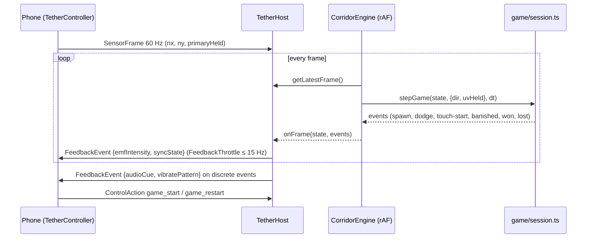

# Design Document — phantom-beam

## Overview

The game separates pure rules from rendering:

- `src/host/game/` holds the rules: `session.ts` (`createGame`, `startGame`, `stepGame`, `snapshot`), `emf.ts` (`computeEmf`, `aimDirection`, `alignment`) and `types.ts`. It has no DOM and no Three.js, so it can be simulated headless.
- `src/host/CorridorEngine.ts` holds the Three.js scene and rAF loop. It reads phone input, calls `stepGame`, and mirrors state into lights, sprites and particles.
- `src/host/HostApp.tsx` glues it together: phone feedback (throttled), desktop audio, the React HUD at 10 Hz, and start/restart actions.
- The phone side is `PhantomController.tsx` + `EmfMeter.tsx` + `audio/GeigerCounter.ts`.

## Architecture

## Components and Interfaces

| Unit | Interface |
| --- | --- |
| `stepGame(state, {dir, uvHeld}, dt, rand)` | Mutates state and returns `GameEvent[]` |
| `snapshot(state)` | Returns `PhantomSync` (phase, lostReason, timeLeft, sanity, score, banished, total, progress, locked, touching) |
| `CorridorEngine` | `new (container, {readInput, onFrame})`, `start()`, `startHunt()`, `dispose()` |
| `AmbientSynth` | `unlock()`, `update(state)`, `banish()`, `shriek()`, `win()`, `lose()`, `setVolume()`, `setMuted()` |
| `GeigerCounter` | `start()`, `stop()`, `setEmf(emf)` |

Actions: `game_start`, `game_restart` (+ core `recenter`).

## Data Models

| Constant | Value | Why |
| --- | --- | --- |
| `SESSION_SEC` | 60 | PRD |
| `LOCK_ACQUIRE_DEG` / `LOCK_COS` | 10° / cos(10°) ≈ 0.9848 | precise centre acquisition |
| `LOCK_HOLD_DEG` / `LOCK_HOLD_COS` | 14° / cos(14°) ≈ 0.9703 | hysteresis: stable under hand tremor |
| `REVEAL_COS` / `EDGE_COS` | 0.90 / 0.80 | full beam / outer edge |
| `BANISH_SEC` | 2.0 | PRD FR-PHAN-04 |
| `TOUCH_DISTANCE` | 1.6 m from the player | contact |
| `TOUCH_DRAIN_PER_SEC` | 20 | ~5 s of contact = loss |
| `WALK_SPEED` | 1.0 m/s × (1 − 0.5·EMF), eased (k = 2.5/s); 0 while UV held or touched | Req 7 |
| `MAX_WALK` | 38 m (corridor is 64 m; the rest stays in fog) | Req 7.3 |
| Wraith speed | 0.7 m/s (0.3 lit), spawns 24 m ahead of the player | retuned for walking |
| Mimic speed | 0.5 m/s forward, 2.2 m/s strafe, 9 m/s dodge, spawns 18 m ahead | retuned for walking |
| Spawn plan | t = 1, 9, 20, 31 s | max 2 active |
| Footstep | every 0.75 m walked | Req 7.5 |
| Scare cooldown | 4 s | Req 9.3 |

Positional audio: `ghostVoices(state, viewYaw)` (pure, `game/voices.ts`) gives each ghost `pan = clamp(1.4·sin(atan2(dx, −dz) − viewYaw))` and `proximity = clamp01(1 − distance/22)`. `AmbientSynth` keeps one voice graph per ghost id (noise → filter → gain → `StereoPannerNode`) and fades voices out when their ghost disappears.

Downstream sync gains `depth`, `walking`, `scare` (a counter), `scareKind` and `scares`. The phone shows its own scare when `scare` changes, so no new protocol message type is needed.

Fog reveal factor: `max(0.2, clamp01((26 − distance)/10))`.

## Correctness Properties

| # | Property | Validates |
| --- | --- | --- |
| G1 | `computeEmf` ∈ [0, 1] for any distance/cos, and is monotonic: closer or better aligned never lowers EMF | 2.2 |
| G2 | EMF downstream messages are never closer than 66 ms (core `FeedbackThrottle`, PBT P10) | 2.3 |
| G3 | Banish progress only increases on the locked ghost while UV is held, and is always within [0, 1] | 4.1, 4.2 |
| G4 | `banished ≤ total`. A phase leaves `playing` exactly once per session (won / lost) | 5.1, 5.3 |
| G5 | Balance (with auto-walk, UV pressed only when LOCKED): perfect aim wins in ≈ 19 s; a 3 s-reaction player in ≈ 25 s; a 5 s-reaction player with ±6° aim wobble in ≈ 32 s, having walked ≈ 18 m. An idle player loses to sanity (≈ 26 s). Random sweeping with UV held loses | 5, 7 |
| G6 | Auto-walk: the player only moves forward, never past `MAX_WALK`, and not at all while UV is held, while a ghost is already touching, or outside a hunt. Ghosts never cross the player's contact line. An empty corridor is walked at ~1 m/s | 7 |
| G7 | Precise lock cone: acquisition is inside 10°, retention inside 14°; alignment is monotonic as aim moves toward the centre, and acquire < hold | 4.1 |

G1, G3, G4, G6 and G7 are fast-check properties in `phantom-beam/tests/game.pbt.test.ts`. The G3/G4 property runs random play that mixes random aim with "aim at the nearest ghost" steps, so banishes and endings actually happen. G2 is covered by the core throttle property P10.

G5 was checked with a headless simulation of `stepGame` over 5 seeds × 4 strategies. That run led to tightening the fog-reveal factor, because ghosts were lockable at their 24 m spawn point.

## Error Handling

- No WebGL → the engine constructor throws inside React's effect, and the page shows nothing beyond the HUD. Documented as a known limitation (all target browsers support WebGL).
- Desktop audio is locked until a gesture. A "Click anywhere to enable sound" button stays visible until then.
- The phone UV button unmounts between hunts, so the controller releases `primaryHeld` whenever the phase is not `playing`.

## Testing Strategy

- Property-based tests for G1, G3 and G4: `pnpm --filter phantom-beam test`. The `run-game-pbt-on-edit` hook runs them on every save of `src/host/game/**`.
- Headless rules simulation (G5) with `tsx`.
- Browser E2E: emulator connect → START HUNT from the phone → aim through the dev-only `window.__tetherController` hook → reveal, lock, UV Surge → AREA PURIFIED on both screens → PLAY AGAIN from the phone. The run also measures the EMF event rate on the phone (max 11/s in the run, below the 15/s cap).
