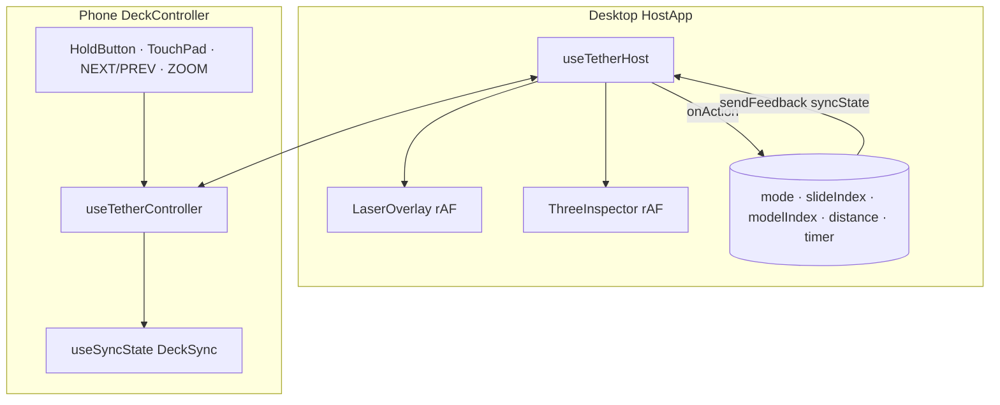

# Design Document — tether-deck

## Overview

One Vite build serves two roles. `/` lazy-loads `host/HostApp` (Three.js), and `/control` lazy-loads `controller/ControllerApp`, which is about 4 KB gzip on top of the shared chunk. All app-specific messaging is defined in `src/shared/deck-protocol.ts` on top of TetherProtocol.

## Architecture



## Components and Interfaces

| Component | Notes |
| --- | --- |
| `HostApp.tsx` | Owns app state, handles `DeckAction`s, pushes `DeckSync` on every change and on connect, handles keyboard/clicker and local file loading |
| `SlidePresenter.tsx` | 16:9 container-query stage; inline Markdown tokens rendered as React elements |
| `LaserOverlay.tsx` | Canvas with DPR scaling and a `Float32Array` ring buffer of 12 points, additive glow |
| `ThreeInspector.tsx` | Renderer, RoomEnvironment PMREM, shadows, clutch-orbit quaternion math, zoom easing, mouse fallback, model swapping and disposal |
| `assets/models.ts` | Procedural models + `parseGlb` |
| `assets/tetherkit-deck.md` | Built-in 5-slide deck (dogfoods the Markdown parser) |
| `DeckController.tsx` | Mode tabs, notes + timer, swipe/trackpad pads, pinch coalescing (≤ 20 msg/s), HoldButton (Space hotkey) |

### Actions (`DeckAction`)
`slide_next`, `slide_prev`, `mode_set {mode}`, `zoom {factor ∈ (0.5, 2)}`, `model_next`, `timer_toggle`, `timer_reset` (+ core `recenter`).

### Sync (`DeckSync`)
`mode, slideIndex, totalSlides, slideTitle (≤ 200 chars), notes (≤ 1500 chars), elapsedSec, remainingSec, talkSec, timerRunning, modelName, modelIndex, modelCount`. Text is truncated so a sync always fits the 4096-char message cap.

## Data Models

Clutch orbit, run every frame while held:

```
qYaw   = axisAngle(Y,  (nx − nx₀) · π)
qPitch = axisAngle(X, −(ny − ny₀) · 0.75π)
qRoll  = axisAngle(Z, −(roll − roll₀) · π)
target = qYaw · qPitch · qRoll · q₀          (world-space)
model.quaternion.slerp(target, 1 − e^(−18·dt))
```

Laser mapping: `x = (nx + 1)/2 · width`, `y = (1 − ny)/2 · height`.

## Correctness Properties

| # | Property | Validates |
| --- | --- | --- |
| D1 | Slide index always stays in [0, totalSlides − 1] whatever the action sequence (clamped `step`) | 2.1 |
| D2 | Zoom distance always stays in [2.2, 9]; out-of-range or non-finite factors are ignored | 3.3 |
| D3 | Releasing and re-grabbing never jumps the model: at grab time the target equals the current orientation | 3.2 |
| D4 | Parsing arbitrary Markdown never produces HTML; every slide has a non-empty title | 2.6 |

These are app-level invariants enforced by construction (clamps and type guards in `HostApp`, token rendering in `SlidePresenter`) and checked in the browser E2E run.

## Error Handling

- Invalid `.glb` → message in the inspector label. Files over 50 MB are rejected before reading.
- Markdown with no slides → dismissible notice; the current deck stays.
- Unknown action names or payloads → ignored.

## Testing Strategy

- E2E (Playwright against the dev server): emulator connect, laser pixels drawn while dragging, NEXT on the phone → desktop 2/5 and phone shows the new title, mode switch → inspector, orbit drag. Plus a second context over real P2P and a third with ICE blocked → RELAY.
- Visual review of screenshots for slide layout, laser trail and inspector lighting.
