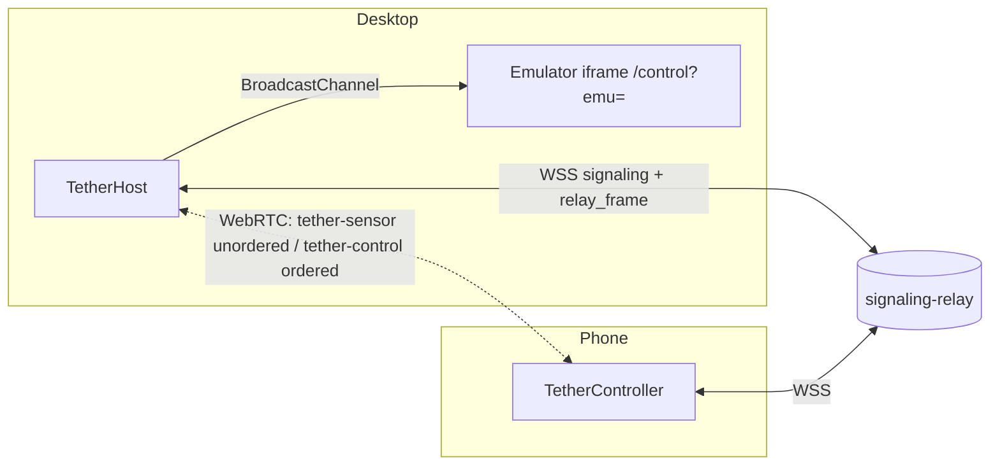
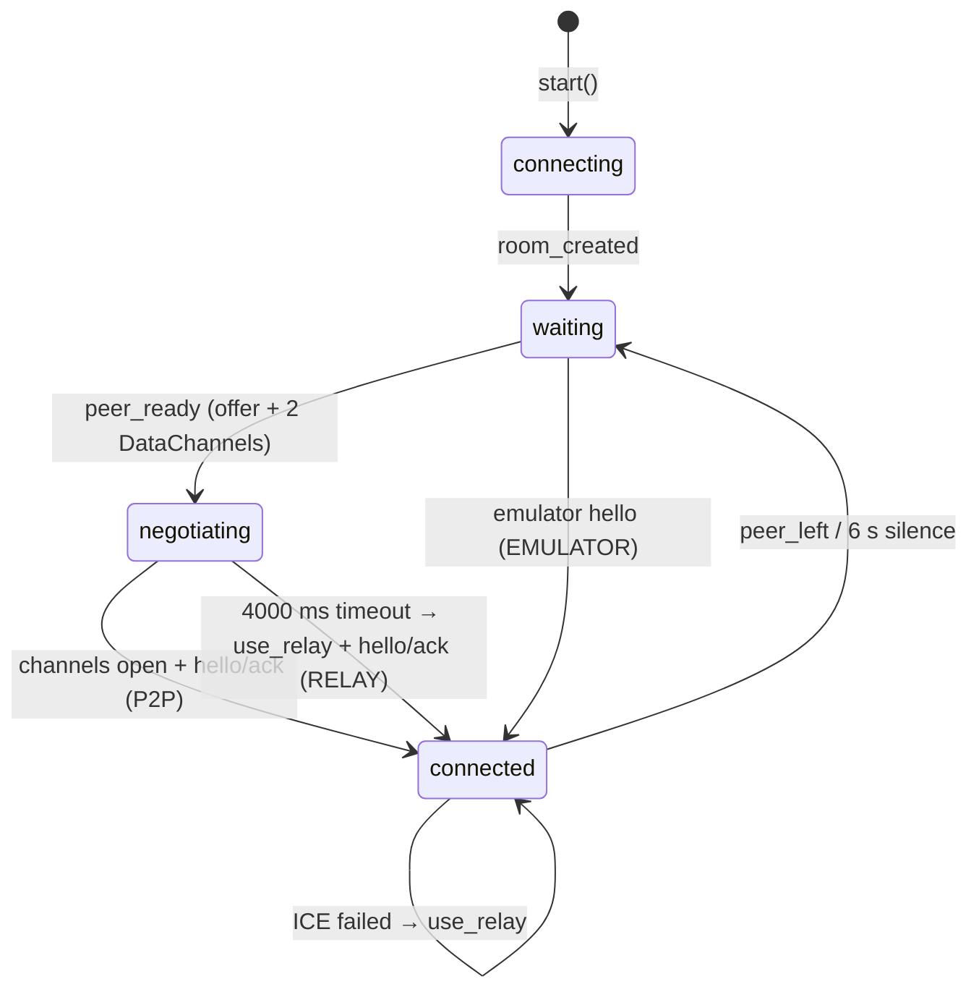

# Design Document — tether-protocol

## Overview

The core is split into five layers. Each layer depends only on the layers below it:

```
react/      hooks + UI kit (PairingCard, VirtualPhoneEmulator, TelemetryHud, ConnectScreen, TouchPad, HoldButton, EdgeGlow, PoseDot)
host.ts / controller.ts   session state machines
transport/  SignalingClient · RtcSession · BroadcastLink · signal-types (shared with relay)
protocol/   types · codec · FrameOrderGuard          sensors/  math · pipeline · touch · environment · orientation-source
                                                     feedback/ vibration · synth · dispatcher · wake-lock · throttle
```

Sensor frames never pass through React state. Apps read `host.getLatestFrame()` in their own `requestAnimationFrame` loop.

## Architecture

### Topology



### Connection state machine



The Controller mirrors it: `connecting → negotiating → connected`, plus `reconnecting` (WS dropped, backoff 1→8 s), `host-left` and `error` (fatal codes `ROOM_NOT_FOUND`, `BAD_TOKEN`, `ROOM_FULL`, `REPLACED`, `ROOM_EXPIRED`).

### Active link selection (Host)

The Host tracks two sources, `remote` (P2P or relay) and `emulator`. A `hello` always makes its source active and resets the seq guard. Messages from a non-active source are ignored while the active source is fresh (seen < 6 s ago). When the active source goes stale or closes, the other live source takes over.

## Components and Interfaces

| Module | Responsibility |
| --- | --- |
| `protocol/types.ts` | `SensorFrame`, `ControlAction`, `FeedbackEvent`, `HelloMessage`, `HelloAck`, `Ping/Pong`, `StatusMessage` |
| `protocol/codec.ts` | `encodeMessage`, `decodeMessage` (never throws, clamps, 4096-char cap) |
| `protocol/seq-guard.ts` | `FrameOrderGuard.accept(seq)` |
| `sensors/math.ts` | `wrapDeltaDegrees`, `orientationToPose`, `AxisSmoother`, clamps |
| `sensors/pipeline.ts` | `SensorPipeline.calibrate/process` |
| `sensors/touch.ts` | `TouchTrackpad.move/set/reset` |
| `sensors/environment.ts` | platform / in-app browser detection, `requestOrientationPermission()` |
| `feedback/*` | `sanitizeVibrationPattern`, `TactileSynth`, `FeedbackDispatcher`, `WakeLockManager`, `FeedbackThrottle` |
| `transport/*` | `SignalingClient`, `RtcSession`, `BroadcastLink`, relay wire types |
| `react/LinkedBurst.tsx`, `react/LinkedFlash.tsx` | Link-confirmation moment on desktop and phone (Req 12). UI only: no protocol change |
| `host.ts` | `TetherHost` (room, negotiation, fallback, emulator, latency/Hz metrics) |
| `controller.ts` | `TetherController` (gesture-bound connect, 60 Hz pump, hello/ack, feedback) |

### Signaling contract (`transport/signal-types.ts`)

Client → server: `register_host {app, resume?}`, `join_room {roomId, token?}`, `signal_offer|signal_answer|signal_ice {data}`, `use_relay {reason?}`, `relay_frame {ch, d}`, `ping`.
Server → client: `room_created`, `joined`, `peer_ready`, `peer_left {role}`, forwarded signals, `use_relay`, `relay_frame`, `pong`, `error {code, message}`.

## Data Models

### Wire formats
- SensorFrame (60 Hz, about 50 bytes): `[1,"s",seq,ts,src(0 gyro|1 touch),nx,ny,roll,held(0|1)]`. Angles are quantized to 1e-4 and `ts` to 0.1 ms.
- Every other message is a JSON object with `v: 1` and `type`.

### Sensor math
- W3C Euler `(α, β, γ)`, Z-X'-Y''. The device +Y (top edge) in world space is `f = (−sinα·cosβ, cosα·cosβ, sinβ)`.
- `yaw = atan2(fx, fy)`, `pitch = asin(fz)`. Roll is the signed angle of the device +X axis around `f`, measured against the horizontal reference `h = normalize(fy, −fx, 0)`.
- `nx = clamp(wrap(yaw − yaw0)/35°)`, `ny = clamp((pitch − pitch0)/35°)`, `roll = clamp(wrap(roll − roll0)/45°)`, then a One Euro filter per axis.
- One Euro: `a(fc, dt) = 1 / (1 + 1/(2π·fc·dt))`, speed `ẋ` smoothed at 1 Hz, cutoff `fc = 1 Hz + 8·|ẋ|`, output `x̂ = a·x + (1 − a)·x̂`, and `dt` from `event.timeStamp` clamped to [1, 100] ms. Each output is a convex combination, so the [-1, 1] bound holds by construction.
- Measured at 60 Hz (offline comparison, `docs/TESTING.md`): a step reaches 90 % in 33 ms (the old EMA needed 100 ms), the lag following a 90°/s turn is 6 ms (old: 31 ms), and still-hand jitter is about half.
- Gyro frames are sent from the `deviceorientation` handler itself. The 60 Hz timer only covers touch input and keepalives, and unforced sends are capped at 60 Hz.

## Correctness Properties

*A property is a characteristic that should hold for all valid executions. Each one below is implemented with fast-check in `tetherkit-core/tests`.*

| # | Property | Validates | Test file |
| --- | --- | --- | --- |
| P1 | **Angle wrapping bounds**: for any a, b in [0, 360), `wrapDeltaDegrees(a, b)` ∈ [−180, 180), `wrap(a, a) = 0`, `b + wrap(a, b) ≡ a (mod 360)`, and it stays finite for any input | 5.2 | sensor-math |
| P2 | **Calibration identity**: after `calibrate(s)`, `process(s)` = (0, 0, 0). Recentering after arbitrary motion re-zeroes | 5.1 | sensor-math |
| P3 | **Normalized output clamp**: for any sample stream (NaN, ±∞, 1e308…), the gyro pipeline and touch trackpad outputs are finite and in [−1, 1] | 5.4 | sensor-math |
| P4 | **No boundary jump**: a real rotation of δ ∈ [−20°, 20°] from any α₀ gives `nx = −δ/35` even when α wraps | 5.2 | sensor-math |
| P5 | **Sensor frame round-trip**: `decode(encode(f))` keeps seq/source/held exact and nx/ny/roll within 5e-5. Frames are ≤ 80 chars | 6.1 | protocol |
| P6 | **Decoder robustness**: for any string / JSON / near-miss envelope, `decodeMessage` returns null or a well-formed message | 6.4 | protocol |
| P7 | **Normalization stability**: after one encode/decode cycle, further cycles are the identity | 6.4 | protocol |
| P8 | **Monotonic sequence guard**: accepted seqs strictly increase and stale frames are always rejected | 6.2 | protocol |
| P9 | **Vibration sanitizer**: output ≤ 10 integer entries in [0, 1000] with sum ≤ 10 000, idempotent, valid patterns unchanged | 8.1 | feedback |
| P10 | **Feedback throttle**: accepted offers are ≥ 66 ms apart, and a 60 Hz caller always gets a send within heartbeat + 1 frame | 8.4 | feedback |
| P11 | **One Euro filter**: the output stays within the range of its inputs for any timestamps (NaN, duplicate, backwards), settles on a held value within 1 s, and lags a fast turn (≥ 1.5 units/s) less than the old EMA | 5.3, 5.4 | sensor-math |

## Error Handling

- Malformed or oversized messages are dropped (`decodeMessage` → null). The relay answers `BAD_MESSAGE`.
- WebRTC setup errors → relay. ICE `failed`, or `disconnected` for more than 2.5 s → relay.
- Signaling socket loss: the Host reconnects with exponential backoff (1→10 s) and resumes the room. The Controller reconnects (1→8 s) with its token, and again immediately on `visibilitychange → visible`.
- Fatal relay errors stop Controller reconnects and show a human-readable message on the connect screen.
- Wake Lock, Vibration and Battery APIs are best-effort and never throw into app code.

## Testing Strategy

- **Property-based tests** (fast-check, ≥ 100 runs, 2000 for decoder and sanitizer): P1–P10. They run on every save of `tetherkit-core/src/{protocol,sensors,feedback}` through the `run-core-pbt-on-edit` hook.
- **End-to-end** (manual or Playwright, documented in `docs/TESTING.md`): emulator path, real P2P between two browser contexts, forced ICE failure → relay in about 4.9 s, and the phantom-beam full hunt.
- **Bundle budget**: `pnpm size`, where the core must stay below 25 KB gzip.
